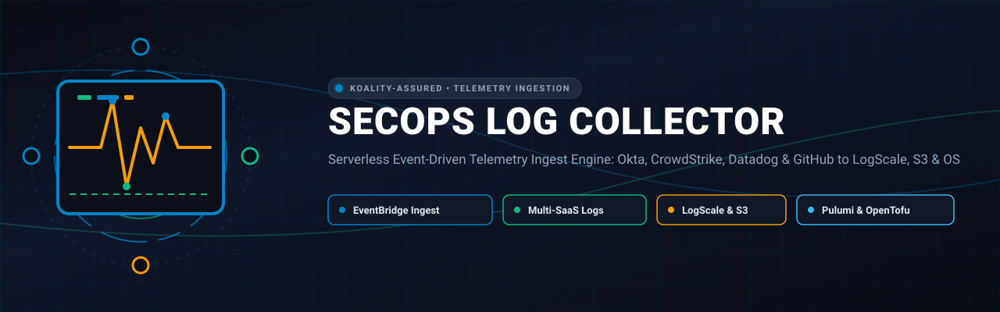
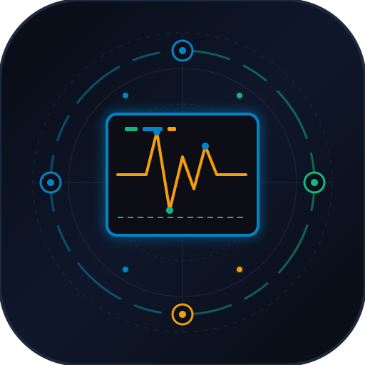

<div align="center">



# SecOps Log Collector

<p align="center">
  
</p>

**Serverless Event-Driven Telemetry Ingest Engine: Okta, CrowdStrike, Datadog & GitHub to LogScale, S3 & OS**

[](https://github.com/Koality-Assured/secops-log-collector/actions/workflows/ci.yml)
[](LICENSE)
[](pyproject.toml)
[]()
[](https://conventionalcommits.org)

</div>

---

## Architecture Overview

```mermaid
flowchart TD
    subgraph Sources["Security Telemetry Sources"]
        S1["Okta System Log API<br/>(/api/v1/logs)"]
        S2["CrowdStrike Falcon<br/>(OAuth2 Spotlight / Events)"]
        S3["Datadog Logs API<br/>(/api/v2/logs/events/search)"]
        S4["GitHub Enterprise Audit<br/>(/orgs/{org}/audit-log)"]
        S5["SentinelOne Activities<br/>(/web/api/v2.1/activities)"]
    end

    subgraph Orchestration["Event-Driven Serverless Collection Engine"]
        EB["AWS EventBridge Scheduler<br/>(Periodic Rate & Cron)"]
        IAM["Least-Privilege IAM Roles<br/>(Service Execution & Invocation)"]
        SM["AWS Secrets Manager / Env<br/>(Credential Resolution & TTL Cache)"]
        ST["State Checkpoint Store<br/>(S3 / SSM / In-Memory Watermarks)"]
        RL["Robust Rate Limiter<br/>(HTTP 429 & Full-Jitter Backoff)"]
        LMB["AWS Lambda Engine<br/>(secops_collector.pipeline)"]

        EB -->|Triggers| LMB
        IAM -.->|Authorizes| LMB
        SM <-->|Credentials| LMB
        ST <-->|Cursors & Watermarks| LMB
        RL <-->|Throttling Control| LMB
    end

    subgraph Sinks["Pluggable Ingestion Destinations"]
        D1["CrowdStrike LogScale / Humio<br/>(/api/v1/ingest/json)"]
        D2["AWS S3 Security Data Lake<br/>(Partitioned Gzip NDJSON)"]
        D3["OpenSearch / Elasticsearch<br/>(_bulk Bulk API Indexing)"]
    end

    S1 -->|RFC 5988 Link Pages| LMB
    S2 -->|FQL & 'after' Cursors| LMB
    S3 -->|JSON Search Cursors| LMB
    S4 -->|Time-Window Pages| LMB
    S5 -->|nextCursor Pagination| LMB

    LMB -->|Batch Ingest| D1
    LMB -->|Compressed S3 Objects| D2
    LMB -->|Bulk Indexing Requests| D3
```



---

## Core Capabilities

- **Modular Source Plugins:** Standardized collectors for Okta, CrowdStrike Falcon, Datadog, GitHub Enterprise, and SentinelOne.
- **Pluggable Output Sinks:** Simultaneously streams batches to CrowdStrike LogScale (Humio), AWS S3 Security Data Lake, and OpenSearch / Elasticsearch clusters.
- **Adaptive Rate Limiting:** Honors RFC 7231 / RFC 9110 `Retry-After` headers (both seconds and HTTP-dates), combined with randomized exponential backoff and full jitter.
- **Zero Data Loss Checkpointing:** Tracks pagination tokens and timestamp watermarks across ephemeral Lambda invocations via S3, SSM Parameter Store, or in-memory stores.
- **Enterprise Security & Sanitization:** Zero hardcoded credentials or proprietary identifiers. Full validation via automated antagonistic security verification scripts.
- **Multi-Cloud IaC:** Complete, declarative Infrastructure as Code modules provided in both **Pulumi (Python)** and **OpenTofu / Terraform**.

---

## Repository Structure

```
secops-log-collector/
├── secops_collector/
│   ├── core/
│   │   ├── models.py            # Pydantic schemas (LogEvent, LogBatch, TimeWindow, CollectorConfig)
│   │   ├── rate_limiter.py      # HTTP 429 adaptive retry engine with RFC Retry-After compliance
│   │   ├── secrets.py           # AWS Secrets Manager & Environment credential provider with caching
│   │   ├── state.py             # S3, SSM, and In-Memory watermark checkpoint managers
│   │   └── pipeline.py          # Orchestrator handling collection, batching, and sink delivery
│   ├── sources/
│   │   ├── base.py              # Abstract BaseSource class and time rounding logic
│   │   ├── okta.py              # Okta System Log API collector
│   │   ├── crowdstrike.py       # CrowdStrike Falcon Event / Vulnerability collector
│   │   ├── datadog.py           # Datadog Logs API collector
│   │   ├── github.py            # GitHub Enterprise Audit Log API collector
│   │   └── sentinelone.py       # SentinelOne Activity and Alert Log API collector
│   ├── sinks/
│   │   ├── base.py              # Abstract BaseSink class
│   │   ├── logscale.py          # CrowdStrike LogScale / Humio JSON ingest sink
│   │   ├── s3.py                # S3 Security Data Lake partitioned gzip sink
│   │   └── opensearch.py        # OpenSearch / Elasticsearch bulk ingest sink
│   └── lambda_handler.py        # AWS Lambda entrypoint
├── infra/
│   ├── pulumi/                  # Declarative Pulumi Python module
│   │   ├── Pulumi.yaml
│   │   ├── config.py
│   │   └── __main__.py
│   └── opentofu/                # Declarative OpenTofu / Terraform module
│       ├── main.tf
│       ├── variables.tf
│       ├── outputs.tf
│       └── terraform.tfvars.example
├── tests/                       # Comprehensive unit and integration test suite
├── adversarial_review.py        # Antagonistic security and leak verification harness
├── pyproject.toml               # Modern packaging and tool configuration
└── README.md
```

---

## Quickstart & Local Execution

### 1. Installation

```bash
git clone https://github.com/koality-assured/secops-log-collector.git
cd secops-log-collector
uv venv
source .venv/bin/activate  # Or .venv\Scripts\activate on Windows
uv pip install -e ".[dev]"
```

### 2. Running Unit Tests

```bash
python -m pytest -v
```

### 3. Running Antagonistic Security Verification

```bash
python adversarial_review.py
```

---

## Configuration & Credentials

Credentials are dynamically loaded from AWS Secrets Manager or environment variables.

### Example Secrets Schema

#### Okta (`secops-okta-credentials`)
```json
{
  "okta_url": "https://example.okta.com",
  "okta_token": "00aBcDeFgHiJkLmNoPqRsTuVwXyZ"
}
```

#### CrowdStrike Falcon (`secops-crowdstrike-credentials`)
```json
{
  "base_url": "https://api.crowdstrike.com",
  "client_id": "0123456789abcdef0123456789abcdef",
  "client_secret": "abcdef0123456789abcdef0123456789"
}
```

#### CrowdStrike LogScale Sink (`secops-sink-logscale-credentials`)
```json
{
  "logscale_url": "https://cloud.humio.com/api/v1/ingest/json",
  "token": "xxxxxxxx-xxxx-xxxx-xxxx-xxxxxxxxxxxx"
}
```

---

## Infrastructure Deployment

### Deploying via Pulumi (Python)

```bash
cd infra/pulumi
pulumi stack init prod
pulumi config set aws:region us-west-2
pulumi config set environment prod
pulumi up
```

### Deploying via OpenTofu / Terraform

```bash
cd infra/opentofu
cp terraform.tfvars.example terraform.tfvars
tofu init
tofu plan -out=tfplan
tofu apply tfplan
```

---

## License

Licensed under the Apache License, Version 2.0. See [LICENSE](LICENSE) for details.